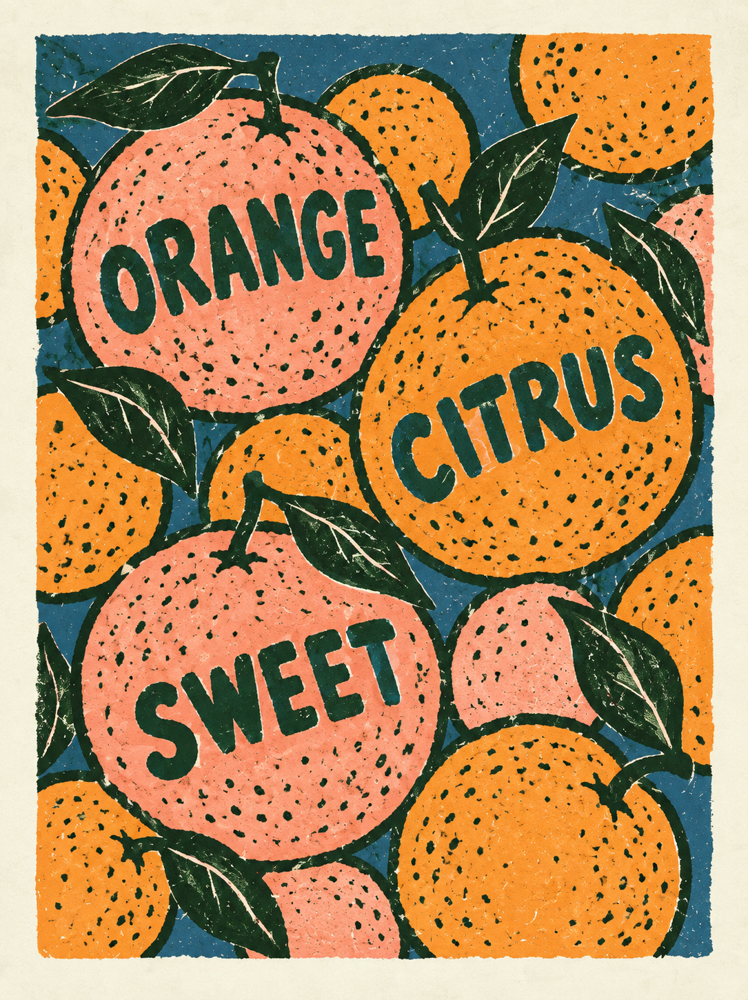
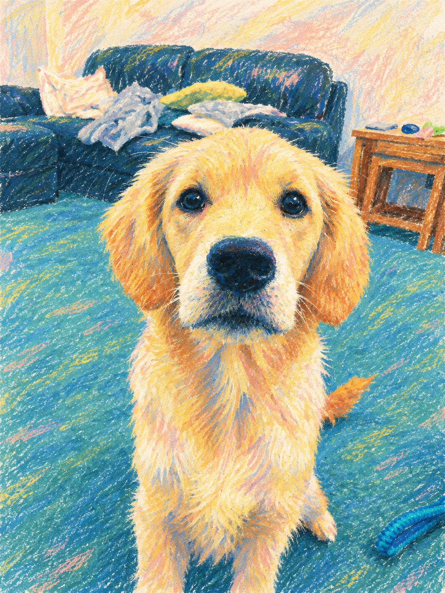
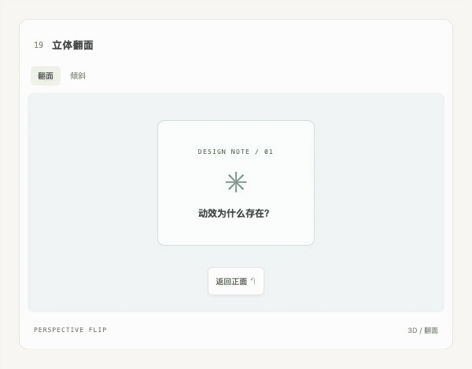
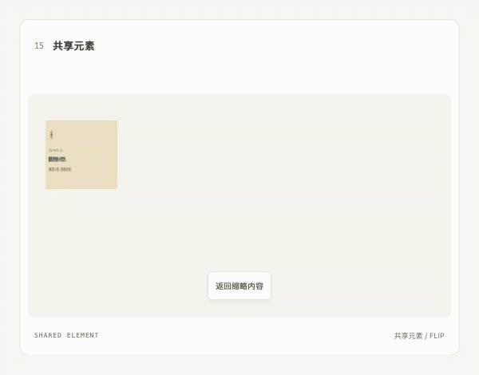
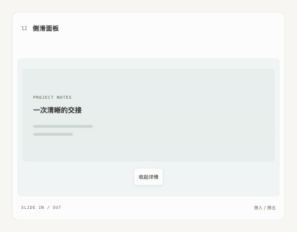
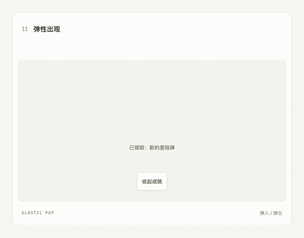

<h1 align="center">qc-skills</h1>
<p align="center"><strong>清晰思考，自由创作。</strong><br>Small, focused skills for thinking & creating.</p>
<p align="center">
  <a href="#qc-alchemy">精选技能</a> ·
  <a href="examples/alchemy/">效果画廊</a> ·
  <a href="#qc-motion-design">交互动效</a> ·
  <a href="#install">安装使用</a> ·
  <a href="#skills">全部技能</a>
</p>

---

<a id="qc-alchemy"></a>

## qc-alchemy · 一张参考图，另一种视觉世界

从参考图中拆解构图、色彩、材质与视觉关系，写成可执行的复刻提示词，再迁移到你的主体。支持模板重演、跨主体适配，以及保留结构换画法。

*Turn visual references into actionable prompts and transferable styles.*

<table>
  <tr>
    <th width="25%">原图 · Source</th>
    <th width="25%">风格参考 · Reference</th>
    <th width="50%">生成结果 · Result</th>
  </tr>
  <tr>
    <td align="center"><a href="examples/alchemy/01-395/source.jpg"></a></td>
    <td align="center"><a href="examples/alchemy/01-395/reference.webp"></a></td>
    <td align="center"><a href="examples/alchemy/01-395/result.png"></a></td>
  </tr>
</table>

**梦幻星芒 / Dreamlight** — 将日常肖像重演为星光、剪影与粉红点阵眼镜构成的幻想画面。[查看实际提示词 →](examples/alchemy/01-395/prompt.txt)

### 更多可能 / More transformations

<table>
  <tr>
    <td width="33%" align="center"><a href="examples/alchemy/#case-405"></a><br><strong>水母夜城</strong><br><sub>场景重构 · Scene transformation</sub></td>
    <td width="33%" align="center"><a href="examples/alchemy/#case-396"></a><br><strong>柑橘版画</strong><br><sub>海报转译 · Poster adaptation</sub></td>
    <td width="33%" align="center"><a href="examples/alchemy/#case-400"></a><br><strong>蜡笔伙伴</strong><br><sub>保留结构换画法 · Structure-preserving restyle</sub></td>
  </tr>
</table>

**[浏览全部 10 组对照案例 →](examples/alchemy/)** · [阅读技能说明](skills/published/qc-alchemy/SKILL.md)

<sub>以上为技能迭代过程中的精选结果，部分经过多轮修正，并非当前版本一次运行的统一测试。完整画廊保留原图、参考、实际提示词与各案例的生成条件。</sub>

<a id="qc-motion-design"></a>

## qc-motion-design · 让交互变化有据可循

设计、实现与审查组件动效，处理反馈、状态切换、拖拽、缓动与减少动态效果。随 skill 附带 **Motion cases：28 个可操作组件、36 种模式、72 条实现提示词**，可浏览效果、查看设计原因与原文索引，也可复用代码。

**[查看 Motion cases 交互动效案例与运行说明 →](examples/motion-cases/)**

<table>
  <tr>
    <td width="50%" align="center"><a href="examples/motion-cases/media/flip.gif"></a><br><strong>立体翻面</strong><br><sub>保留空间关系，揭示另一面</sub></td>
    <td width="50%" align="center"><a href="examples/motion-cases/media/shared.gif"></a><br><strong>共享元素</strong><br><sub>从缩略到详情，保持对象连续</sub></td>
  </tr>
</table>
<table>
  <tr>
    <td width="33%" align="center"><a href="examples/motion-cases/media/slide.gif"></a><br><strong>侧滑面板</strong><br><sub>滑入详情，保留上下文</sub></td>
    <td width="33%" align="center"><a href="examples/motion-cases/media/stagger.gif"></a><br><strong>错峰展开</strong><br><sub>依次出现，解释任务顺序</sub></td>
    <td width="33%" align="center"><a href="examples/motion-cases/media/pop.gif"></a><br><strong>弹性出现</strong><br><sub>轻微超调，回应成就反馈</sub></td>
  </tr>
</table>

<sub>以上 GIF 来自实际案例，按原动画时间轴每 20ms 逐帧采集，保留原始缓动与错峰；起止状态增加短暂停留便于观察。GIF 的计时精度与色彩受格式限制，完整交互请运行 Motion cases。</sub>

```bash
npx skills add https://github.com/AIDiscovery007/qc-skills --skill qc-motion-design
```

安装后，把目标页面或代码交给 Agent：

> 使用 qc-motion-design，参考 Motion cases 的按钮按压反馈，为当前提交按钮添加动效，沿用项目样式并处理键盘和减少动态效果路径。

想先看案例，可以说：“启动 qc-motion-design 随附的 Motion cases”。进入案例的 **Source Notes**，选择“从零实现”或“优化已有”，复制提示词即可开始。

**[案例运行与使用说明 →](skills/published/qc-motion-design/assets/motion-cases/README.md)** · [阅读技能说明](skills/published/qc-motion-design/SKILL.md)

<a id="install"></a>

## 安装 / Install

安装 `qc-alchemy`：

```bash
npx skills add https://github.com/AIDiscovery007/qc-skills --skill qc-alchemy
```

附上原图和风格参考后，可以这样开始：

> 使用 qc-alchemy，以图 1 为主体，按图 2 的构图、色彩和材质重演画面。先给出可执行提示词，再生成结果。

生成图片需配合可用的图像生成工具；也可以只提取提示词或风格方案。

<details>
<summary>查看可安装技能 / 安装全部</summary>

```bash
npx skills add https://github.com/AIDiscovery007/qc-skills --list
npx skills add https://github.com/AIDiscovery007/qc-skills --all
```

</details>

<a id="skills"></a>

## 技能目录 / Skills

### Published · 正式发布

| Skill | 用途 / Purpose |
| :--- | :--- |
| [qc-alchemy](skills/published/qc-alchemy/SKILL.md) | 参考图逆向、视觉风格提炼与主体适配 / Reference-driven visual recreation |
| [qc-motion-design](skills/published/qc-motion-design/SKILL.md) | 组件交互动效设计、实现与审查 / Frontend interaction motion · [Motion cases](examples/motion-cases/) |
| [qc-image-series](skills/published/qc-image-series/SKILL.md) | 封面、轮播与系列图片的一致提示词 / Consistent image-series prompts |
| [qc-essence](skills/published/qc-essence/SKILL.md) | 提炼问题、文章与方案的关键本质 / Distill the decisive essence |
| [qc-skills-setup](skills/published/qc-skills-setup/SKILL.md) | 将 AGENTS.md 桥接到 Claude 风格的指令 / Agent instruction compatibility |

### Incubating · 迭代中

| Skill | 用途 / Purpose |
| :--- | :--- |
| [qc-expert-casting](skills/incubating/qc-expert-casting/SKILL.md) | 为问题选择合适的专家视角，生成提示词或子代理指令 / Cast an expert lens |

## 仓库结构 / Repository

```text
skills/published/           # 正式发布的技能
skills/incubating/          # 迭代中的技能
skills/archive/             # 已归档，不参与分发
examples/alchemy/           # 10 组原图、参考、结果与实际提示词
examples/motion-cases/      # 动效案例入口；完整资源位于 skill 的 assets/motion-cases/
.claude-plugin/plugin.json  # 分发清单
templates/skill/            # 编写模板
scripts/list-skills.sh      # 列出正式发布的技能
```

<details>
<summary>Maintainer notes / 维护者说明</summary>

### Distribution Rules / 分发规则

- `.claude-plugin/plugin.json` is the distribution manifest used by `npx skills`.
- "Release/publish a version" means adding the skill's current path to the manifest; it does not require moving the skill to `skills/published/`.
- Only move a skill to `skills/published/` when explicitly doing a formal published release.
- `skills/incubating/` skills may be distributed for iteration when they are intentionally added to the manifest.
- `skills/archive/` is never added to the manifest; rename retired entrypoints to `SKILL.md.archived` so `npx skills` does not discover them.
- Every distributable skill must contain a `SKILL.md`.
- Skill `name` and `description` should be in English for reliable agent triggering.

- `.claude-plugin/plugin.json` 是 `npx skills` 使用的分发清单。
- “发布一版”表示把 skill 当前路径加入分发清单，不要求移动到 `skills/published/`。
- 只有明确做“正式发布”时，才把 skill 移动到 `skills/published/`。
- `skills/incubating/` 中的 skill 可以作为迭代版进入分发清单。
- `skills/archive/` 永远不进入分发清单；退役入口改名为 `SKILL.md.archived`，避免被 `npx skills` 自动发现。
- 每个可分发的 skill 都必须包含 `SKILL.md`。
- skill 的 `name` 和 `description` 建议使用英文，便于 agent 稳定触发。

</details>
